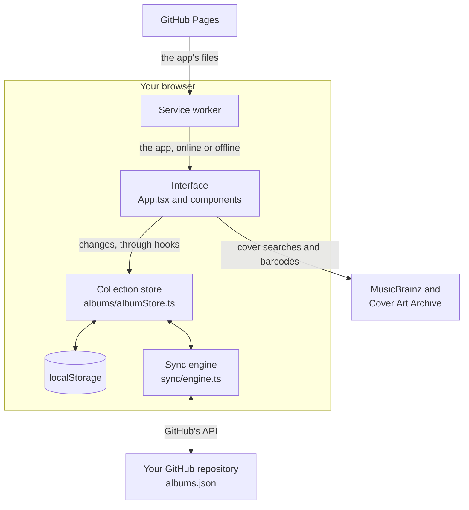
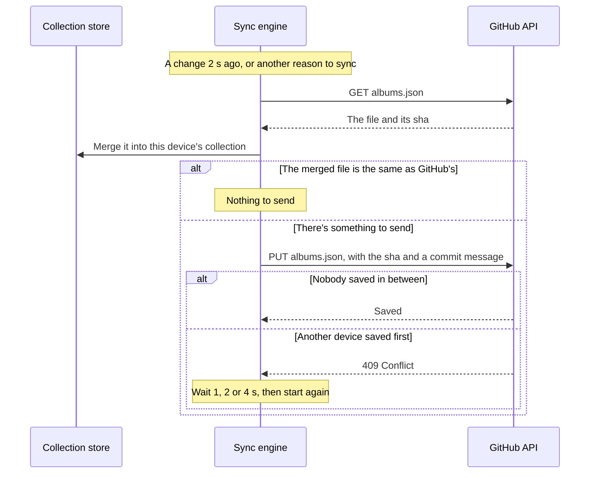

# Architecture

This document explains how Album Tracker is built: what each part does, where
it lives, how the parts work together, and why they were built that way. It's
for anyone changing the code. For what the app does and how to use it, see the
[README](README.md).

When a change makes something here wrong, update it in the same pull request.

## Contents

- [The big picture](#the-big-picture)
- [Principles](#principles)
- [Tech stack](#tech-stack)
- [Where things are](#where-things-are)
- [The data](#the-data)
- [Where data is kept](#where-data-is-kept)
- [How a change travels](#how-a-change-travels)
- [The screen](#the-screen)
- [Album rules](#album-rules)
- [Covers](#covers)
- [Barcodes](#barcodes)
- [Import and export](#import-and-export)
- [Sync](#sync)
- [Offline and updates](#offline-and-updates)
- [Look and feel](#look-and-feel)
- [Tests](#tests)
- [Build, releases and deploys](#build-releases-and-deploys)
- [Recipes](#recipes)
- [Decisions and trade-offs](#decisions-and-trade-offs)
- [Known limitations](#known-limitations)

## The big picture

Album Tracker is a static web app: HTML, JavaScript and CSS, served by GitHub
Pages. There's no Album Tracker server, API or database. Everything happens in
the browser, which talks to two outside services directly.



- **The interface** is React with Ant Design. There's one screen,
  `src/App.tsx`, with the albums as a grid or a list. Everything else opens in
  a dialog over it.
- **The collection** is saved in the browser's `localStorage`, behind a small
  store that the interface and the sync engine share.
- **MusicBrainz and the Cover Art Archive** are called straight from the
  browser, to find covers and look up barcodes. Neither needs a key, and both
  allow requests from other sites.
- **Sync** is optional. Once it's on, the sync engine keeps the collection in
  step with `albums.json` in a GitHub repository that belongs to the user.
- **A service worker** keeps the app's files and the covers on the device, so
  the app opens and works offline.

## Principles

A few ideas explain most of the decisions below.

- **No server of its own.** Album Tracker isn't a hosted service. Anything
  stored beyond one browser goes somewhere each person sets up for themselves:
  their own GitHub repository. Nobody has to run, pay for or trust a server.
- **Local first.** The collection is read and saved on the device, without
  waiting for the network. Covers, barcodes and sync add to the app, but it
  works without them.
- **Don't lose albums.** Everything read from outside is checked. A file the
  app can't fully read is left alone rather than saved over. Deleting can be
  undone, deleted albums are remembered so sync can't bring them back, and
  connecting a device offers an export before replacing its albums.
- **Plain TypeScript under a thin React layer.** Only `App.tsx`,
  `src/components` and `src/hooks` use React. The rules for albums, files,
  sync and the outside services are plain functions and objects, which the
  tests call directly.
- **Load only what's needed.** The barcode reader loads the first time someone
  scans, covers load as they scroll into view, and the first paint doesn't
  wait for the JavaScript.

## Tech stack

| What                                            | Used for                                    | Why                                                                                                                              |
| ----------------------------------------------- | ------------------------------------------- | -------------------------------------------------------------------------------------------------------------------------------- |
| React 19 and TypeScript (strict)                | The interface and everything else           | Components and hooks suit a single interactive screen, and types catch mistakes in the data rules                                |
| Vite 8                                          | The dev server and the build                | Fast, with little config. The build runs `tsc` first, so type errors fail it                                                     |
| Ant Design 6, antd-style, `@ant-design/icons`   | Components, theming and styles              | A complete, accessible set of components with light and dark themes. antd-style writes each component's styles with theme tokens |
| vite-plugin-pwa (Workbox)                       | The service worker and the web app manifest | Installable and offline with a few lines of config                                                                               |
| `barcode-detector` and `zxing-wasm`             | Reading barcodes where the browser can't    | The same API as the browser's own `BarcodeDetector`, backed by ZXing compiled to WebAssembly                                     |
| Vitest, Testing Library and jsdom               | Tests                                       | Vitest shares Vite's config, and Testing Library tests the app the way people use it                                             |
| ESLint and Prettier                             | Linting and formatting                      | Checked in CI                                                                                                                    |
| GitHub Actions, release-please and GitHub Pages | CI, releases and hosting                    | Free, with nothing to run                                                                                                        |

There's no router, state library or data-fetching library. The app has one
screen, one small store and a handful of `fetch` calls, so they wouldn't earn
their weight.

## Where things are

| Path                 | What it is                                                                                                                                        |
| -------------------- | ------------------------------------------------------------------------------------------------------------------------------------------------- |
| `index.html`         | The page. It sets the theme before the first paint, shows a copy of the header until React takes over, and has the link preview tags              |
| `vite.config.ts`     | The base path, the version, the service worker and manifest, and the test setup                                                                   |
| `public/`            | Icons and the link preview image, copied into the build as they are                                                                               |
| `.github/workflows/` | CI, releases and deploys                                                                                                                          |
| `src/main.tsx`       | Starts React, and loads antd's reset CSS                                                                                                          |
| `src/App.tsx`        | The screen. It creates the store, uses the hooks, lays out the components, and holds what's on screen: the search, filters, selection and dialogs |
| `src/types.ts`       | The types shared across the app, like `Album`, `Collection` and `Settings`                                                                        |
| `src/vite-env.d.ts`  | Vite's types, and `__APP_VERSION__`                                                                                                               |

Tests sit next to the code they test, as `*.test.ts` or `*.test.tsx`.

### `src/albums`: albums and their rules

| File              | What it does                                                                                                             |
| ----------------- | ------------------------------------------------------------------------------------------------------------------------ |
| `albumStore.ts`   | The collection store: saves the albums and deleted albums in `localStorage`, and announces every change, other tabs' too |
| `albumFiles.ts`   | Checks albums read from files (`toAlbum`), finds duplicates, adds imported albums, and words import summaries            |
| `albumFormats.ts` | The five formats, their labels, and the names files use for them                                                         |
| `albumYears.ts`   | Reads years, and works out decades                                                                                       |
| `albumList.ts`    | Searches, filters and sorts the albums for the screen, and lists the artists and decades to filter by                    |
| `timestamps.ts`   | Reads and compares dates, and picks the time to record a change at                                                       |

### `src/api`: the outside services

| File               | What it does                                                                         |
| ------------------ | ------------------------------------------------------------------------------------ |
| `musicBrainz.ts`   | Requests to MusicBrainz, with retries, and the helpers the two files below share     |
| `coverArt.ts`      | Finds covers by title and artist                                                     |
| `barcodeLookup.ts` | Finds an album by its barcode                                                        |
| `github.ts`        | A small GitHub client: open a repository, read and save a file, and explain failures |

### `src/barcodes`: reading barcodes

| File               | What it does                                                         |
| ------------------ | -------------------------------------------------------------------- |
| `barcodeReader.ts` | Picks a barcode reader: the browser's own, or ZXing's                |
| `zxingReader.ts`   | Loads ZXing and its WebAssembly file, only when the browser needs it |

### `src/importExport`: files

| File           | What it does                                                     |
| -------------- | ---------------------------------------------------------------- |
| `json.ts`      | Writes and reads JSON exports                                    |
| `csv.ts`       | Writes and reads CSV files, including Discogs collection exports |
| `downloads.ts` | Saves an export as a file named with the date                    |

### `src/sync`: syncing through GitHub

| File             | What it does                                                                              |
| ---------------- | ----------------------------------------------------------------------------------------- |
| `engine.ts`      | The sync engine: when to sync, a sync round, connecting and disconnecting, and the status |
| `merge.ts`       | Merges this device's collection with the repository's                                     |
| `syncFile.ts`    | Writes and reads `albums.json`, and words the commit messages                             |
| `config.ts`      | Saves the repository and token on the device                                              |
| `setupCode.ts`   | Setup codes, to connect another device                                                    |
| `githubLinks.ts` | Links to GitHub's forms for a new repository and a new token, filled in                   |
| `syncStatus.ts`  | Puts the sync status in a sentence                                                        |

### `src/hooks`: React hooks

| File               | What it does                                                                    |
| ------------------ | ------------------------------------------------------------------------------- |
| `useAlbums.ts`     | The albums, and every change to them: add, edit, mark, delete with undo, import |
| `useGitHubSync.ts` | Creates and starts the sync engine, and follows its state                       |
| `useSettings.ts`   | This device's settings                                                          |
| `useThemeMode.ts`  | Light, dark or the system's theme, whichever was chosen                         |
| `useMediaQuery.ts` | Whether a CSS media query matches                                               |

### `src/components`: the interface

Each component has a folder with an `index.tsx`, and some an `index.test.tsx`.
`src/components/index.ts` only exports the ones `App.tsx` uses. The rest are
parts of those.

| Component            | What it is                                                                                                                            |
| -------------------- | ------------------------------------------------------------------------------------------------------------------------------------- |
| `Layout`             | The theme, the header (name, version, sync icon and theme menu) and the page background. `theme.ts` beside it has the theme overrides |
| `AlbumFilters`       | Search, sort, the status, format, artist and decade filters, and the album count                                                      |
| `AlbumViewToggle`    | Grid or list                                                                                                                          |
| `MoreActionsMenu`    | The ⋯ menu: select albums, sync, export, import and settings                                                                          |
| `AlbumCard`          | An album in the grid                                                                                                                  |
| `AlbumRow`           | An album in the list                                                                                                                  |
| `AlbumByline`        | The artist and year, like "Miles Davis · 1959"                                                                                        |
| `AlbumStatusSwitch`  | Owned or wishlisted, switched in one click                                                                                            |
| `AlbumNotesButton`   | Shows an album's notes in a popover                                                                                                   |
| `AlbumActionButtons` | The edit and delete buttons                                                                                                           |
| `AlbumCheckbox`      | Picks an album in selection mode                                                                                                      |
| `SelectionBar`       | What to do with the selected albums                                                                                                   |
| `AlbumFormModal`     | The add and edit dialog                                                                                                               |
| `AlbumCoverField`    | The cover field, and the cover search                                                                                                 |
| `BarcodeScanDialog`  | The camera or a typed number, and the barcode lookup                                                                                  |
| `SettingsDialog`     | The grid density and the format for new albums                                                                                        |
| `SyncSetupDialog`    | Connects to a repository, as a new setup or with a setup code                                                                         |
| `SyncSettingsDialog` | The sync status, Sync now, the setup code, the token and Disconnect                                                                   |
| `SyncStatusButton`   | The sync icon in the header                                                                                                           |
| `ThemeMenu`          | The theme button in the header, with Light, Dark and System to pick from                                                              |
| `ExternalLink`       | A link that opens in a new tab                                                                                                        |
| `formRules.ts`       | Form checks the sync dialogs share                                                                                                    |

### `src/test` and `src/utils`

| File                 | What it does                                                                                           |
| -------------------- | ------------------------------------------------------------------------------------------------------ |
| `test/setup.ts`      | Runs before the tests: adds jest-dom's matchers, stands in for browser APIs jsdom lacks, and cleans up |
| `test/NoMotion.tsx`  | Turns off antd's animations in tests                                                                   |
| `test/fakeGitHub.ts` | A stand-in for GitHub's API, and in-memory storage for more devices                                    |
| `utils/base64.ts`    | Base64 for any text, not just Latin-1                                                                  |
| `utils/urls.ts`      | Checks that a URL is http or https                                                                     |

### Which folder uses which

Each layer only imports from the layers below it:

1. `App.tsx`
2. `components`
3. `hooks`
4. `sync`
5. `api`, `importExport` and `barcodes`
6. `albums`
7. `utils` and `types.ts`

So `albums` knows nothing about sync or the screen, and nothing below `hooks`
knows about React. Keep it that way: it's what lets the tests check the rules
without rendering anything.

## The data

Everything is defined in `src/types.ts`. An `Album` has:

| Field       | Type               | Notes                                                      |
| ----------- | ------------------ | ---------------------------------------------------------- |
| `id`        | string             | A random UUID, given when it's added                       |
| `title`     | string             | Required                                                   |
| `artist`    | string             | Required                                                   |
| `year`      | number, optional   | The year it came out                                       |
| `coverUrl`  | string, optional   | An http or https URL                                       |
| `format`    | string, optional   | `vinyl`, `cd`, `cassette`, `digital` or `other`            |
| `status`    | string             | `owned` or `wishlisted`                                    |
| `notes`     | string, optional   | Anything else, like the pressing or its condition          |
| `addedAt`   | ISO date, optional | When it joined the collection. Sorts **Recently added**    |
| `updatedAt` | ISO date, optional | When it last changed. Decides which copy wins when syncing |

Albums saved before the app kept dates have no `addedAt` or `updatedAt`.
Everything that compares dates treats a missing one as older than any other.

The other types:

- **`AlbumInput`** is an album without its id and dates: what the add and edit
  form fills in.
- **`DeletedAlbum`** (`{ id, deletedAt }`) remembers a deletion, so other
  devices delete their copy too, rather than syncing it back.
- **`Collection`** (`{ albums, deleted }`) is everything saved about the
  collection, and what the store and sync work with.
- **`Settings`** has the grid density, the format for new albums, and the view
  and sort order last chosen. Settings belong to the device and aren't synced.

## Where data is kept

The app saves everything in `localStorage`:

| Key                         | Holds                                              | Used by                                                        |
| --------------------------- | -------------------------------------------------- | -------------------------------------------------------------- |
| `album-tracker:albums`      | The albums, in the order they were added           | `albums/albumStore.ts`                                         |
| `album-tracker:deleted`     | The ids of deleted albums, and when                | `albums/albumStore.ts`                                         |
| `album-tracker:settings`    | The settings                                       | `hooks/useSettings.ts`                                         |
| `album-tracker:theme`       | `light` or `dark`, or nothing to follow the system | `hooks/useThemeMode.ts`, and `index.html` before the app loads |
| `album-tracker:github-sync` | The repository and token, while syncing            | `sync/config.ts`                                               |

Every key starts with `album-tracker:`, because the storage is shared with
anything else on the same origin. Settings, the theme and the sync config fall
back to their defaults when they're missing or can't be read. The service
worker keeps the app's files and covers in caches of its own, as
[Offline and updates](#offline-and-updates) explains.

Why `localStorage` rather than IndexedDB:

- It's synchronous, so the first render already has the albums, with no
  loading state.
- Another tab's changes arrive as `storage` events, which keeps open tabs in
  step for free.
- A personal collection is small: an album takes a few hundred bytes.

The costs: browsers allow about 5 MB for each origin, every change rewrites the
whole list, and Safari can clear it for sites that aren't opened for a while,
unless they're on the Home Screen. Sync and exports are the backup.

### The collection store

`createCollectionStore()` in `albums/albumStore.ts` is the only code that reads
or writes the album keys:

- **`get()`** returns the collection. It never changes in place: every change
  makes a new object, so React can tell what changed by comparing references.
- **`update(change)`** passes the collection to `change`, and saves what it
  returns. Returning the same object means nothing changed: nothing is saved,
  nobody is told, and nothing syncs. Only the lists that changed are written.
- **`subscribe(listener)`** calls the listener after every change. The first
  subscriber also starts listening for `storage` events, so a change in another
  tab reloads the lists and tells everyone.

`App.tsx` creates one store, with `useState(createCollectionStore)`, and gives
it to both `useAlbums` and `useGitHubSync`. So the interface and the sync engine
see the same collection, and each sees the other's changes.

### The hooks

**`useAlbums(store)`** reads the collection with `useSyncExternalStore`, and
returns the albums and the ways to change them. Each change is a function of
the current collection, given to `store.update`, and records its time with
`nextTimestamp`:

- `addAlbum` gives the album a UUID, and sets `addedAt` and `updatedAt`.
- `updateAlbum` does nothing if no detail changed (`sameDetails`), so opening
  the form and saving it as it is doesn't make a commit.
- `setAlbumsStatus` marks albums as owned or wishlisted.
- `deleteAlbums` removes albums, remembers their deletion, and returns a
  function that undoes it. Undoing puts them back where they were, gives them a
  new `updatedAt` so they win over the deletion when syncing, and forgets the
  deletion.
- `importAlbums` adds the albums that aren't in the collection yet.

**`useSettings`** fills in a default for any setting that's missing or can't
be read. It reads the storage again before each save, so it can't undo a change
made in another tab, and follows other tabs through `storage` events.

**`useThemeMode`** returns the theme chosen (light, dark or system) and whether
it's dark. System, the default, follows the device's theme, as it changes.

**`useGitHubSync(store)`** creates the sync engine once, starts it in an effect
(whose cleanup stops it), and reads its state with `useSyncExternalStore`.

## How a change travels

Editing an album, from the click to the commit:

1. **Edit** on an `AlbumCard` calls `openEditForm` in `App.tsx`, which opens
   `AlbumFormModal` with the album.
2. On **Save**, the form checks its fields, trims them, turns the year into a
   number and calls `onSubmit`. `App.tsx` passes the result to `updateAlbum`.
3. `updateAlbum` calls `store.update`. If nothing changed, it returns the
   collection as it was, and that's the end of it. Otherwise it returns a new
   collection with the edited album and a new `updatedAt`.
4. The store saves `album-tracker:albums` and tells its subscribers. React
   renders the change through `useSyncExternalStore`, and other open tabs get
   a `storage` event and reload it.
5. The sync engine is a subscriber too. It sees that the collection no longer
   matches what GitHub has, shows **pending**, and waits 2 seconds, starting
   over with each change, so a burst of changes makes one commit.
6. Then it runs a sync round: it fetches `albums.json`, merges, and saves it
   with a commit message like `Edit "Kind of Blue" by Miles Davis`. The icon
   shows **synced**.

## The screen

`App.tsx` holds two kinds of state:

- **What's on screen:** the search, the status, format, artist and decade
  filters, the selection, and which dialog is open. These last until the page
  closes.
- **Settings:** the view (grid or list) and the sort order, saved so that each
  device opens the way it was left, plus the grid density and the format for
  new albums.

From top to bottom, it renders `Layout` with the header; the toolbar, with
`AlbumFilters` on one side and `AlbumViewToggle`, **Add album** and
`MoreActionsMenu` on the other; `SelectionBar` in selection mode; and the albums
that `selectAlbums` picks, as `AlbumCard`s in a grid or `AlbumRow`s in a list.
The dialogs come last: `AlbumFormModal`, `SyncSetupDialog`, `SyncSettingsDialog`
and `SettingsDialog`.

Some details:

- **Confirmations and messages** come from `Modal.useModal()` and
  `message.useMessage()`, with their holders rendered inside `Layout`, so they
  pick up the theme. antd's static `Modal.confirm()` and `message` wouldn't.
- **Deleting** asks first, with the focus on **Cancel** so Enter can't delete
  by accident. A message then offers **Undo** for 8 seconds.
- **Selection mode** swaps each album's buttons for a checkbox. Only albums
  still shown count as selected, so a filter can't hide what gets changed.
  Escape ends it, unless the focus is in a dialog.
- **The decade filter** only appears once an album has a year. If the decade
  chosen disappears, say because its last album was deleted, the filter stops
  applying, so a hidden filter can't hide albums.
- **The grid** has 5, 4, 3, 2 or 1 columns, from the widest screens to phones,
  or 6 to 2 when it's compact. Compact cards also have half the padding around
  their details, using antd's small card size.
- **The add and edit form** wraps the whole dialog in its `Form`, through
  `modalRender`, so Enter and the button in the footer submit it, and the footer
  can see the fields. A click outside doesn't close it, so a half-filled form
  isn't lost. While the title, artist and format match an album already in the
  collection, it shows a warning and its button reads **Add anyway** or **Save
  anyway**. **Scan a barcode** only shows when adding.
- **Covers** in the grid and list are ``, so only the ones
  near the screen load. One that's missing or fails to load shows a
  placeholder.

## Album rules

These live in `src/albums`.

- **Checking albums from outside.** Albums from imports and from `albums.json`
  go through `toAlbum`. An album needs a title, an artist and a status of
  `owned` or `wishlisted`, or it can't be read. Other fields are kept only if
  they're valid: a cover must be an http or https URL, a year a whole number
  from 1000 to 9999, and a date an ISO date and time. A format is read by name
  or by a common name for it, and anything else counts as `other`. Text is
  trimmed, and an album without an id gets a new UUID.
- **Duplicates.** `findDuplicate` matches the title and artist, ignoring case
  and spaces around them. The format only tells two albums apart when both have
  one: a vinyl and a CD copy of an album can both be added, but an album without
  a format matches either. The form warns about duplicates, imports skip them,
  and connecting to sync counts the albums only this device has.
- **Formats.** `toFormat` understands the names files use, like `LP`, `12"`,
  `Compact Disc`, `tape` or `FLAC`, and Discogs' `2xLP, Album, RE`, whose first
  part is the medium.
- **Years.** `toYear` reads a number, or text that starts with four digits,
  like "1959-08-17". The form accepts years up to next year, for albums on the
  way.
- **Search, filters and sort.** `selectAlbums` keeps the albums whose title or
  artist contains the search, and that pass every filter, then sorts them. The
  artist filter ignores case. The year sorts put albums without a year last,
  either way, and sort albums from the same year by artist, then title.
  **Recently added** sorts by `addedAt`, newest first. Albums from before the
  app kept dates come last, newest of them first: the reverse of the order
  they're saved in.
- **Times.** `nextTimestamp` records a change at the current time, or 1 ms
  after the newest time already in the collection, if that's later. That way, a
  device whose clock runs behind can't make its new changes look older than ones
  it already has, which would make them lose when syncing.

## Covers

- **Finding covers.** **Find covers** in the form calls `searchCovers`
  (`api/coverArt.ts`). It searches MusicBrainz's release groups, which are
  albums across all their editions, by title and artist, and returns up to 8.
  Their covers come from the Cover Art Archive by release group: the 250 px
  thumbnail in the picker, and the 500 px image saved with the album. Search
  terms are lowercased and escaped, because MusicBrainz reads them as Lucene
  queries, where an uppercase "AND" in a title would be an operator.
- **Missing covers.** Not every album on MusicBrainz has a cover, and there's
  no asking without loading it, so thumbnails that fail to load are dropped from
  the picker. If they all fail, the picker says the archive may not have them,
  or may be down.
- **Picking a cover** fills in the year too, if it's empty or was filled in by
  the cover picked before. A year that was typed stays.
- **Any image works.** The cover field takes any http or https URL.
- **MusicBrainz requests** all go through `getFromMusicBrainz`
  (`api/musicBrainz.ts`). MusicBrainz turns requests away in short bursts when
  it's busy, so it retries 502, 503 and 504 answers and dropped connections,
  after 1, 2 and 4 seconds. When the browser is offline, it gives up straight
  away. Failures throw a `MusicBrainzError`, with `offline` or `unavailable` as
  the reason, for the interface to explain. Each request takes an
  `AbortSignal`, so closing a dialog cancels its requests.

## Barcodes

1. **Scan a barcode** in the add form opens `BarcodeScanDialog`.
2. It asks for the camera with `getUserMedia`, preferring the one on the back,
   and shows what it sees.
3. It creates a barcode reader with `createBarcodeReader`, and reads a frame
   every 250 ms.
4. A barcode of 8 to 14 digits is looked up on MusicBrainz with
   `lookUpBarcode`. While a lookup runs, no other starts, and a barcode that
   stays in view isn't looked up again.
5. If MusicBrainz knows it, the title, artist, year, format and cover are filled
   in, and the dialog closes. The status and notes stay as they were.

The number under the barcode can be typed instead, which is also the way to go
when there's no camera, no permission to use it, or no secure connection.

**Two readers.** `createBarcodeReader` uses the browser's own `BarcodeDetector`
when it reads EAN-13, the barcode on most albums, as Chrome on Android does.
Otherwise, as on iPhones, it loads ZXing: the `barcode-detector` package's
ponyfill, which has the same API, backed by ZXing compiled to WebAssembly
(`zxing-wasm`). It's loaded with `import()`, so neither ZXing's code nor its
950 kB `.wasm` file is part of the app's main bundle.

**The `.wasm` file is served with the app,** imported with Vite's `?url`, rather
than from the CDN the library uses by default. Scanning makes no requests to a
third party, and doesn't depend on that CDN. The file has to match ZXing's
JavaScript, so `zxing-wasm` is pinned to the exact version `barcode-detector`
was built for, and `zxingReader.test.ts` fails if they differ.
`prepareZXingModule` loads the file straight away, so a failure shows as
"Couldn't load the barcode reader" instead of as barcodes never being found,
and `purgeZXingModule` lets the next scan try again.

**The camera only runs while the dialog is open.** Closing it unmounts its
contents (`destroyOnHidden`), which stops the camera and cancels a lookup.
Frames are read on the device, and only the number goes to MusicBrainz.

**The lookup** (`api/barcodeLookup.ts`) searches MusicBrainz's releases for the
barcode. A UPC-A barcode is an EAN-13 one without its leading 0, and MusicBrainz
has both, so it searches for both forms. From the first match, it takes the
release group's title, the artist as credited, the format of its first medium,
and the release group's cover. A release only has its own date, so a second
request gets the year the album first came out. If that fails, the year is left
empty.

## Import and export

These are all in the ⋯ menu, `MoreActionsMenu`.

- **Export as JSON** saves everything about every album:
  `{ "format": "album-tracker", "version": 1, "exportedAt": …, "albums": […] }`.
- **Export as CSV** has the columns Title, Artist, Year, Format, Status, Cover
  URL and Notes. It starts with a byte order mark, so Excel reads it as UTF-8.
  Cells that spreadsheets would run as formulas, like ones starting with `=`,
  get an apostrophe in front, and importing takes it off again.
- **The files** are named `album-tracker-YYYY-MM-DD`, with the local date. They
  download through a temporary object URL, which is kept for 40 seconds because
  Safari can still be reading it after the click.
- **Import** reads a JSON export, or a CSV file with a header row. `albums.json`
  from a sync repository has the same shape as a JSON export, so it can be
  imported too. CSV columns are found by name, ignoring case and anything but
  letters, and by other names for them, like "Released" for the year and
  "Collection Notes" for the notes, as Discogs exports have. The separator is
  whichever of comma, semicolon and tab the header uses most, since Excel uses
  semicolons in some countries. A row without a status is an album you own.
- **Importing only adds.** `mergeAlbums` skips albums already in the collection,
  by id or as duplicates, and never changes or removes one. Imported albums keep
  their `addedAt` if they have one, and get a new `updatedAt`. The message says
  how many albums were added, how many were already there, and how many
  couldn't be read.

## Sync

The README explains sync for the people using it, in
[Sync across devices](README.md#sync-across-devices). This is how it works.

### Why GitHub

Sync had to work without a server of Album Tracker's own, so each person
brings their own storage. A GitHub repository fits:

- Its API takes requests from web pages on other sites, so the app can talk to
  it directly.
- Fine-grained personal access tokens can be limited to one repository's
  contents.
- Every save is a commit, so the history is a backup of every change.
- A save names the version of the file it replaces (its `sha`), and GitHub turns
  it down if the file has changed since, so devices can't overwrite each other's
  changes.
- It's free, and `albums.json` can be read, and even edited, on GitHub.

What was ruled out:

| Option                         | Why not                                                                                        |
| ------------------------------ | ---------------------------------------------------------------------------------------------- |
| A server for Album Tracker     | Someone would have to run it, pay for it and look after everyone's data                        |
| Dropbox                        | Without an app the maintainer registers and runs, each person would have to register their own |
| Google Drive                   | Tokens for apps in the browser last about an hour, with no refresh token to renew them         |
| OneDrive                       | Refresh tokens for apps in the browser expire after 24 hours                                   |
| iCloud                         | Needs the paid Apple Developer Program                                                         |
| Signing in with GitHub (OAuth) | Needs a client secret, so a server, and GitHub's token endpoint doesn't take browser requests  |
| GitHub gists                   | A token that can reach gists can reach every gist on the account                               |

### The file

`albums.json` holds the albums in the same shape as a JSON export, plus the
deleted albums. The app writes it like this:

```json
{
  "format": "album-tracker",
  "version": 2,
  "albums": [
    {
      "id": "7d0c9a52-4b1e-4f8a-9d3c-2e6b1a5f8c47",
      "title": "Kind of Blue",
      "artist": "Miles Davis",
      "year": 1959,
      "format": "vinyl",
      "status": "owned",
      "coverUrl": "https://coverartarchive.org/release-group/…/front-500",
      "notes": "2015 reissue",
      "addedAt": "2025-01-02T10:00:00.000Z",
      "updatedAt": "2025-01-05T18:30:00.000Z"
    }
  ],
  "deleted": [
    {
      "id": "c3e8f1d4-6a2b-4c9e-8f7d-1b5a3e9c2d60",
      "deletedAt": "2025-01-04T09:12:00.000Z"
    }
  ]
}
```

- **Small diffs.** The keys are always in the same order (`ALBUM_KEYS`), and the
  deletions are sorted oldest first, so each commit's diff only shows what
  changed.
- **Versions.** Version 2 added years and notes. An older version of the app
  would drop fields it doesn't know about when it saves, so it refuses to sync
  with a newer file, and asks to be reloaded instead.
- **Strict reading.** The app saves over this file, so it reads it carefully.
  If anything's wrong, it leaves the file alone, and syncing stops with a
  message saying why until it's fixed:
  - If it isn't JSON from Album Tracker, `readSyncFile` throws an
    `InvalidSyncFileError`.
  - If a newer version of the app saved it, a `NewerSyncFileError`.
  - If any album or deletion in it can't be read, perhaps after an edit on
    GitHub, an `UnreadableEntriesError`, since saving would lose them.
- **Albums added on GitHub** without an id, or with one copied from another
  album, get an id made from a hash of their details, so every device gives
  them the same one. The next save writes it into the file.

### When it syncs

| When                                                                                    | Why                                                                  |
| --------------------------------------------------------------------------------------- | -------------------------------------------------------------------- |
| The app starts                                                                          | To catch up with other devices                                       |
| 2 seconds after a change, starting over with each change                                | So a burst of changes makes one commit                               |
| The app comes back into view or gets the focus, 30 seconds or more after the last round | To pick up other devices' changes, without a request at every switch |
| The app is hidden with changes not yet sent                                             | The browser may stop it soon after                                   |
| The connection comes back                                                               | To send what was changed offline                                     |
| **Sync now** in Sync settings                                                           | On request                                                           |
| Another tab connects, changes the token or disconnects                                  | So open tabs follow each other's sync settings                       |

When the engine merges changes from GitHub into the store, it sets `isMerging`,
so they don't count as changes to send.

### A sync round



1. Fetch `albums.json` and its `sha`.
2. Read it, and merge it into this device's collection with
   `mergeCollections`. The store is only updated if that changes something.
3. Write the merged collection as the file's text. If it's the same as the file
   on GitHub, there's nothing to send, and the round is done.
4. Otherwise, save it with the `sha` it was based on, and a commit message from
   `describeChanges`, like `Add 3 albums, edit 1 and delete 1` or
   `Mark "Blue" by Joni Mitchell as owned`.
5. If GitHub answers that the file changed in the meantime, because another
   device saved, wait 1 second and start again from the top, then 2, then 4.
   After that, give up and report it.

Rounds never overlap: one runs at a time, with at most one more waiting behind
it. Across tabs, a Web Lock (`album-tracker:sync`) lets only one tab sync at a
time, so two tabs don't make a commit each. If the repository or token changes
during a round, because another tab disconnected, say, the round stops.

The engine remembers the text of the file it last synced, and compares the
collection with it to know whether there's anything to send. That's the
**pending** status.

### Merging

`mergeCollections(local, remote)` in `sync/merge.ts` runs on every round:

- **For each album, the latest change wins,** by `updatedAt`. On a tie, the
  repository's copy wins, so an edit made on GitHub, which leaves `updatedAt`
  as it was, sticks.
- **A deletion wins over the changes made before it.** If either side deleted
  an album at or after its last change, it's gone. If it changed after it was
  deleted, by an undo or an import, it stays, and the deletion is forgotten.
- **The order** is the repository's, followed by the albums only this device
  has.

It's "last change wins" for each album as a whole: simple, predictable, and the
file stays plain JSON that people can read and edit. For one person's devices,
two changes to the same album between syncs are rare. When they happen, the
later one wins, including fields only the earlier one changed. The README lists
what this means for people in [Limitations](README.md#limitations).

Deletions are remembered forever. Otherwise, a device that was offline for a
while would bring deleted albums back. Each takes under 100 bytes.

### Statuses

| Status         | In the header         | Meaning                                             |
| -------------- | --------------------- | --------------------------------------------------- |
| `disconnected` | Nothing               | Not syncing                                         |
| `syncing`      | Spinning arrows       | A round is running                                  |
| `synced`       | A cloud               | Up to date, as of the last round                    |
| `pending`      | A cloud with an arrow | Changes are waiting to be sent                      |
| `offline`      | A broken link         | GitHub couldn't be reached. It syncs when it's back |
| `error`        | A warning             | Something needs attention. Sync settings says what  |

`describeSyncError` in `sync/engine.ts` puts each failure into words: a token
that GitHub doesn't accept or that can't save, a repository it can't find, the
rate limit and when it lifts, repeated conflicts, problems at GitHub, and the
file problems above.

### Connecting

`SyncSetupDialog` has two ways in:

- **New setup** takes a repository and a token. Its links open GitHub's forms
  filled in (`sync/githubLinks.ts`): a private repository called
  `album-collection`, and a fine-grained token called "Album Tracker" with
  read and write access to contents and no expiry. A link can't pick the
  repository for the token, so the dialog says to.
- **Setup code** takes a code copied from a device that's already syncing.

Then it connects:

1. `engine.check` opens the repository with the token, and reads `albums.json`
   if there is one.
2. If the repository is public, it asks first: anyone could see the
   collection.
3. If the repository has a collection, it replaces this device's. If this
   device has albums the repository doesn't, it says how many and offers to
   **Export first**.
4. If it has none, this device's collection starts it: `engine.connect` creates
   `albums.json` with a commit like `Start syncing 12 albums`. If another device
   created it in the meantime, GitHub refuses, and the dialog asks to connect
   again.
5. The repository and token are saved, and a round catches up with anything
   saved since the check.

**Setup codes** (`sync/setupCode.ts`) are `album-tracker-sync:` followed by the
repository and token, as JSON in base64url: one thing to copy and paste, which
messaging apps leave alone. Sync settings copies it to the clipboard, or shows
it to copy by hand if the clipboard can't be used. It includes the token, so
it's only for your own devices. It isn't offered as a QR code: the iPhone's
Camera app finds "No usable data" in a QR code of plain text, so it can't be
copied from one.

**Changing the token** checks that the new one opens the repository before it's
saved. **Disconnecting** forgets the repository and token on this device. The
albums stay as they are, on the device and on GitHub.

### Talking to GitHub

`createGitHubClient(token)` in `api/github.ts` makes three requests to
`api.github.com`:

- `GET /repos/{owner}/{repo}`, to check the repository exists, the token opens
  it, and whether it's private.
- `GET /repos/{owner}/{repo}/contents/albums.json`, for the file and its `sha`.
  Files over 1 MB come without their contents, so those are fetched through the
  Git blobs API.
- `PUT /repos/{owner}/{repo}/contents/albums.json`, to commit the file to the
  default branch, naming the `sha` it replaces.

Requests send the token as a Bearer token, and pin the API version. They also
skip the browser's cache (`cache: "no-cache"`): GitHub lets browsers reuse its
answers for a minute, which could hide another device's save, and checking back
doesn't count against the rate limit when nothing changed. Failures become a
`GitHubError` with a reason:

| Reason         | When                                                                     |
| -------------- | ------------------------------------------------------------------------ |
| `offline`      | The request didn't get an answer                                         |
| `unauthorized` | 401: GitHub doesn't accept the token                                     |
| `forbidden`    | 403: the token can't do this                                             |
| `rate-limited` | 403 or 429 with rate limit headers. Says when the limit lifts, if it can |
| `not-found`    | 404: no such repository, or the token can't open it                      |
| `conflict`     | 409, or 422 when creating a file that already exists                     |
| `unavailable`  | Anything else                                                            |

`parseRepo` accepts `owner/name`, a GitHub URL or a clone address.

### The token

The token is a fine-grained personal access token that can only read and write
the contents of one repository. It doesn't expire, so sync doesn't stop without
warning, and deleting it on GitHub revokes it everywhere.

It's saved in `localStorage`, as plain text, like the albums. Anything running
on the same origin could read it. The app loads no scripts from other sites, and
the token can't reach anything but that one repository. On GitHub Pages, all of
an account's project sites share an origin, `https://<owner>.github.io`, and so
share the storage: only publish sites you trust there, or use a custom domain.

## Offline and updates

vite-plugin-pwa builds the service worker, with Workbox, and the web app
manifest, both configured in `vite.config.ts`. It's off in development.

- **The app's files** are downloaded on the first visit (`globPatterns`): the
  JavaScript, CSS, HTML, icons and manifest. Later visits load them from the
  device, online or not, and opening the app offline gets the saved
  `index.html`. The link preview image, `og-image.png`, is left out, and so is
  ZXing's `.wasm` file: looking a barcode up needs the network anyway, and the
  file is nearly as big as everything else put together.
- **Covers** are saved as they're shown, in a cache called `album-covers` that
  keeps up to 300. They come from other sites without CORS, so the service
  worker can't see whether one loaded, and saves the answer as it is. The cover
  picker's 250 px thumbnails are left out: searching needs the network anyway,
  and a thumbnail that failed during an outage would stay broken.
- **Updates.** `registerSW.js` registers the service worker once the page has
  loaded (`injectRegister: "script-defer"`), so it doesn't hold up the first
  paint. On a later visit, the browser finds a new version, and downloads its
  files in the background. It then waits until no tab or window has the old
  version open, and takes over the next time the app opens. Reloading isn't
  enough while it stays open. `registerType: "autoUpdate"` doesn't change that:
  vite-plugin-pwa only makes a new version take over at once when
  `injectRegister` is `"auto"`.
- **The first paint.** An inline script in `index.html` picks the theme the
  same way `useThemeMode` does, and sets `data-theme` on `<html>`. Inline CSS
  then paints the background and a copy of the header in that theme, so the
  page shows the header straight away, in the right colours, while the
  JavaScript loads. React replaces it on its first render. The CSS uses
  `[data-theme]` selectors rather than `light-dark()`, which the build's CSS
  minifier rewrites into something that doesn't work here. Keep the copy in step
  with `Layout`.
- **The page around the app.** Mobile browsers paint the page's own background
  around their status bar and toolbars, so `PageBackground` in `Layout` keeps
  `data-theme`, `color-scheme` and the background of `<html>` in step with the
  theme.
- **The version** comes from `package.json`, which release-please bumps. A small
  Vite plugin writes it into the header copy in `index.html` (`%APP_VERSION%`),
  and `define` makes it `__APP_VERSION__` for `Layout`.
- **The base path.** GitHub Pages serves the site under `/album-tracker/`, so
  production builds use that as their base, and development uses `/`. It
  depends on the mode rather than the command, so `vite preview` uses it too. A
  copy in a repository with another name changes it, as
  [Run your own copy](README.md#run-your-own-copy) explains.

## Look and feel

- **The theme.** `Layout` gives antd's `ConfigProvider` the theme from
  `components/Layout/theme.ts`: antd's light or dark algorithm, with a few
  colours changed so small text meets WCAG AA's contrast of 4.5:1 in both.
- **Touch screens** (`pointer: coarse`) get 16 px text in text fields and
  selects, because iOS zooms in on a field with smaller text when it's focused.
  Selects keep their 22 px line, so they don't grow taller.
- **Light, dark or system** is picked from the theme button in the header.
  System, the default, follows the device as it changes. Light or dark is
  remembered, until System is picked again.
  The choice is saved as `album-tracker:theme`, which `index.html` reads too.
- **Dialogs** get 24 px of space below them, through the `modal` setting
  `Layout` gives `ConfigProvider`. antd 6 leaves none, so a dialog taller than
  the screen would end flush with its bottom edge.
- **Styles** live with their component, written with antd-style's
  `createStyles` and the theme's tokens, so they follow the theme. The only
  global CSS is antd's reset, loaded in `main.tsx`.
- **Accessibility.** Buttons with only an icon have a label, the album count and
  the sync status are announced as they change (`role="status"`), and
  confirmations that delete or disconnect start on **Cancel**.

## Tests

`npm test` runs them once, and `npm run test:watch` on every change. Vitest runs
them in jsdom, with Testing Library and user-event.

- **The rules are tested directly.** `src/albums`, `src/importExport`, `src/api`
  (with `fetch` replaced) and most of `src/sync` are plain functions, so their
  tests give them data and check what comes back.
- **The sync engine is tested with several devices.** Each `createDevice` in
  `sync/engine.test.ts` has its own in-memory storage, store and engine, all
  talking to `createFakeGitHub`. The fake keeps `albums.json` in memory and
  follows GitHub's rules: a save based on an old `sha` gets a 409, and creating
  a file that exists a 422. Tests can take it offline (`online`), make the next
  request fail (`failNextWith`), or run code when a save arrives
  (`beforeNextSave`), to have another device save at just the wrong moment.
  `commits` lists each commit's message and text.
- **The interface is tested the way people use it.** Most of its tests render
  the whole `<App />` and click through it, including those for the menu, the
  selection bar, and the settings and sync dialogs, so they test the real
  wiring.
- **`src/test/setup.ts`** adds jest-dom's matchers, stands in for `matchMedia`
  and `ResizeObserver`, which jsdom lacks and antd uses, and after each test
  unmounts everything and clears `localStorage`.

Testing antd in jsdom has a few catches:

- Render with `{ wrapper: NoMotion }`. antd's animations never finish in jsdom,
  so closed dialogs would linger.
- antd gives every generated id the same value in tests, so find dialogs by
  their role and text, not by their accessible name.
- A button with an icon and text has the icon's name in its accessible name,
  like "plus Add album", so match it with a regular expression like
  `/add album/i`.
- Popovers, and dialogs opened over another dialog, stay transparent, part way
  through their animation, so check them with `toBeInTheDocument()`, not
  `toBeVisible()`.
- The add and edit form marks optional fields, so their labels read like "Year
  (optional)": match them with `/^Year/`.

jsdom has no layout, camera or service worker, so those are checked by hand in a
browser.

## Build, releases and deploys

- **The build.** `npm run build` runs `tsc`, which type-checks the app and its
  tests, then `vite build`, which writes the site to `dist/`.
- **CI.** `.github/workflows/ci.yml` has one job, `check`: it installs, then
  runs lint, the format check, the tests and the build, on every pull request
  and push to `main`. `main` is protected, so changes land through pull
  requests, and `check` has to pass.
- **Releases.** release-please reads the commit messages on `main`, which
  follow Conventional Commits, and keeps a release pull request open that bumps
  the version and updates `CHANGELOG.md`. Merging it tags a release. See
  [Releases](README.md#releases).
- **Deploys.** When release-please creates a release, its workflow calls
  `deploy.yml`. That runs `check` again, on exactly what's about to go live,
  builds, and publishes `dist/` to GitHub Pages. It can also be run by hand, on
  `main` to publish it again, or on a tag to go back to that version. A deploy
  in progress is never cancelled. See [Deploys](README.md#deploys).
- **Why deploy on release:** the live site is always a released version, with a
  changelog, and merging a pull request doesn't change what people use until
  it's released.

## Recipes

### Add a field to albums

A new field has to survive every path an album takes, including older versions
of the app:

1. `types.ts`: add it to `Album`, which adds it to `AlbumInput` too.
2. `albums/albumFiles.ts`: read and check it in `toAlbum`, or imports and sync
   drop it.
3. `hooks/useAlbums.ts`: compare it in `sameDetails`, or changing only that
   field won't save.
4. `sync/syncFile.ts`: add it to `ALBUM_KEYS`, or it won't sync, and bump
   `VERSION`, so older versions of the app stop syncing instead of dropping it.
5. `components/AlbumFormModal`: add a form field, and pass it on in
   `handleFinish`.
6. Show it, in `AlbumCard`, `AlbumRow` or `AlbumByline`.
7. `importExport/csv.ts`: add a column to `HEADER` and `createCsv`, its names
   to `COLUMNS`, and read it in `readCsv`. JSON exports include it already.
8. Test each of these.

### Add a setting

1. `types.ts`: add it to `Settings`.
2. `hooks/useSettings.ts`: read it in `readSettings`, checking the saved value,
   with a default.
3. `components/SettingsDialog`: add a control, unless it's changed elsewhere,
   like the view and sort order.
4. Use it from `settings` in `App.tsx`.

### Add a sort order or a filter

- **A sort order:** add it to `AlbumSortOrder` in `types.ts`, a comparator to
  `SORT_COMPARATORS` in `albums/albumList.ts`, and an option to `AlbumFilters`.
  `isSortOrder` uses `SORT_COMPARATORS`, so a saved sort order is accepted from
  then on.
- **A filter:** add its state to `App.tsx`, an option and a check to
  `selectAlbums`, and a control to `AlbumFilters`.

### Ask MusicBrainz for something new

Use `getFromMusicBrainz`, for its retries and offline check. Pass it the
component's `AbortSignal`, and catch `MusicBrainzError` to show an offline or
unavailable message. Covers come from `COVER_ART_URL`.

### Save something new on the device

Name the key `album-tracker:…`, check what's read back and fall back to a
default, and listen for `storage` events if open tabs should follow.

## Decisions and trade-offs

| Decision                                                    | Why                                                                                     | The cost                                                                                      |
| ----------------------------------------------------------- | --------------------------------------------------------------------------------------- | --------------------------------------------------------------------------------------------- |
| No server: sync through each person's own GitHub repository | Nothing to run or pay for, people own their data, and the history is a backup           | Setting up sync takes a GitHub account, a repository and a token                              |
| `localStorage`, not IndexedDB                               | Synchronous, so the first render has the albums, and `storage` events keep tabs in step | About 5 MB, the whole list is saved on every change, and Safari can clear it                  |
| One store for the interface and sync                        | Each sees the other's changes, with nothing to wire up                                  | None to speak of                                                                              |
| The latest change wins, for each album                      | Simple and predictable, and the file stays plain JSON                                   | If two devices change different fields of an album between syncs, only the later change stays |
| Deletions remembered forever                                | A device that's been offline can't bring deleted albums back                            | The list only grows, though each entry is tiny                                                |
| The whole collection in one file                            | One request to read it and one to save, and it's easy to read and edit on GitHub        | Devices saving at once conflict, which retrying handles                                       |
| Tokens pasted in, not signing in with GitHub                | Signing in needs a server                                                               | More steps to set up, and a token saved on each device                                        |
| Setup codes to copy, not QR codes                           | The iPhone's Camera app can't copy text from a QR code                                  | Getting the code to the other device is up to you                                             |
| Ant Design                                                  | Complete, accessible components, with themes                                            | A large bundle, which the app shell and the service worker make up for                        |
| The browser's barcode reader, or ZXing loaded when needed   | The browser's is built in, and ZXing covers iPhones without slowing anyone else         | Two paths to test                                                                             |
| Deploy on release, not on merge                             | The site is always a released version                                                   | Merged changes wait for the next release                                                      |

## Known limitations

- **An unreadable album list reads as empty.** If `album-tracker:albums` or
  `album-tracker:deleted` can't be parsed, the store reads it as an empty list,
  and the next change saves over it. With sync on, the next round brings the
  albums back from GitHub. Without it, only an export can.
- **Clocks decide.** Which change is later depends on each device's clock.
  `nextTimestamp` keeps a device's new changes after those it already has, but
  two devices whose clocks are far apart can still pick the wrong winner.
- **Two devices that add the same album** before syncing end up with two
  copies, as they have different ids.
- **Deletions are remembered forever,** so the list only grows.
- **Size.** Every change saves the whole list in `localStorage`, and the whole
  `albums.json` on GitHub. That's fine for a personal collection, but it isn't
  built for tens of thousands of albums.
- **Updates wait** until every tab and window of the app has been closed.
- **The main bundle** is about 1 MB of JavaScript, about 320 kB compressed, and
  Vite warns that it's over 500 kB on every build.
- **jsdom** can't test the layout, the camera or the service worker, so those
  are checked by hand.
