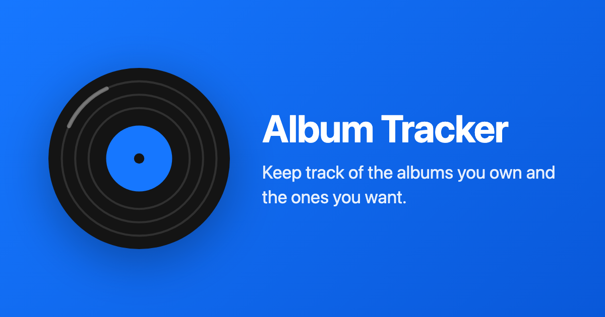

# Album Tracker



Album Tracker keeps track of your music collection: the albums you own, and the
ones you want. It's a web app that works on your phone and your computer,
installs like a regular app and works offline.

There are no accounts, and no Album Tracker server or database. Your
collection is saved on your device, and if you want it on all of them, it syncs
through a GitHub repository of your own.

**Use it at <https://mosaal.github.io/album-tracker/>.**

## Features

- **Your albums:** each has a title, artist, cover, format (vinyl, CD,
  cassette, digital or other) and whether you own it or want it. Find a cover
  by searching [MusicBrainz](https://musicbrainz.org/), or paste a link to one.
  You're warned before adding an album that's already in your collection.
- **Finding them:** search by title or artist, filter by owned or wishlisted,
  format and artist, and sort by title, artist or when you added them. Browse
  them as a grid of covers or as a list. Each device opens with the view and
  sort order you last chose.
- **Quick changes:** switch an album between owned and wishlisted on its card,
  or select several to mark or delete at once. Deleting can be undone.
- **Bringing your list:** import a JSON or CSV file, such as a spreadsheet with
  Title and Artist columns or a [Discogs](https://www.discogs.com/) collection
  export. Export your collection as either, for a backup or a spreadsheet.
- **All your devices:** install it on your phone or computer, use it offline,
  and keep the same collection everywhere with
  [sync](#sync-across-devices).
- **Your way:** light and dark themes, a compact grid that fits more albums
  in, and a format that new albums start with.

## How it works

- **It runs in your browser.** Album Tracker is a static web app (React,
  TypeScript, Vite and Ant Design) hosted on GitHub Pages. It has no backend of
  its own: your device does the work, and only contacts MusicBrainz to find
  covers and, if you turn on sync, GitHub.
- **Your collection is stored on your device,** in the browser's storage, so it
  opens instantly and works offline. Open tabs stay in step with each other.
- **The app is stored too.** Once you've opened it, a service worker keeps the
  app and the covers you've seen on your device. New versions download in the
  background and are used the next time you open it.
- **Covers come from MusicBrainz.** Searching for a cover looks up matching
  albums on MusicBrainz and shows their covers from the
  [Cover Art Archive](https://coverartarchive.org/), straight from your
  browser.
- **Sync goes through your own GitHub repository.** If you turn it on, your
  collection is kept in a file, `albums.json`, in a private repository you own,
  and each device talks to GitHub directly. Changes are merged album by album,
  and each sync is a commit, so the repository's history is a backup.

## What you need

- **To use it:** a recent browser on your phone, tablet or computer. Open
  <https://mosaal.github.io/album-tracker/> and start adding albums. To install
  it on an iPhone or iPad, open it in Safari and choose Share → **Add to Home
  Screen**. In Chrome or Edge, use the install button in the address bar or the
  browser's menu.
- **To keep your collection safe:** it only lives in that browser until you
  back it up or sync it. Clearing the browser's data deletes it, and Safari can
  clear it if you don't open the site for a while, unless it's on your Home
  Screen. Use ⋯ → **Export as JSON** now and then, or turn on sync.
- **To sync across devices:** a free GitHub account. The app helps you create a
  private repository and a token that can only reach it. See
  [Sync across devices](#sync-across-devices).
- **To run your own copy:** a GitHub account as well. See
  [Run your own copy](#run-your-own-copy).

## Sync across devices

Album Tracker keeps your collection in your browser. To have the same
collection on your phone, laptop and anywhere else, sync it through a private
GitHub repository of your own. There's no Album Tracker server or account: the
app talks to GitHub directly, and the repository is yours.

### Set up the first device

1. Open ⋯ → **Sync with GitHub…**.
2. Use **Create a repository** to make a private repository, such as
   `album-collection`, and enter its name.
3. Use **Create a token** to make a fine-grained personal access token. The link
   fills in its name, **Contents: Read and write** and no expiration. Under
   **Repository access**, choose **Only select repositories** and pick the
   repository. Paste the token into the app and select **Connect**.

The first device starts the collection: its albums are saved to `albums.json`
in the repository.

### Add more devices

On a device that's already syncing, open ⋯ → **Sync settings…** and copy the
setup code. On the new device, open ⋯ → **Sync with GitHub…** → **Setup code**
and paste it. The code includes the token, so only paste it on your own devices.

When a device connects to a repository that already has albums, they replace
the ones on that device. If it has albums the repository doesn't, the app offers
to export them first.

On iPhone and iPad, the app added to the Home Screen keeps its own data,
separate from Safari, so connect it as a device of its own.

### How syncing works

- Each device keeps its own copy, so the app works offline. It syncs when it
  opens, a couple of seconds after a change, when you come back to it, and when
  the connection returns. The icon next to the theme switch shows how it's going.
- Each sync is a commit to `albums.json`, so the repository's history is a
  backup of every change.
- You can edit `albums.json` on GitHub too. If an entry can't be read, the file
  is left as it is, and syncing stops with a message until it's fixed.
- The token is stored only in the browser on each device, and can only read and
  write the repository you picked. **Disconnect** in Sync settings removes it
  from a device. To revoke it everywhere, delete it in GitHub's
  [token settings](https://github.com/settings/personal-access-tokens).

### Limitations

- When the same album is changed on two devices before either syncs, the later
  change wins.
- Two devices that add the same album before syncing end up with two copies.
- Which change is later depends on each device's clock.
- Deleted albums are remembered, so a device that still has one can't bring it
  back. The list only grows, but each entry is tiny.

## Run your own copy

You can host your own copy on GitHub Pages for free:

1. Fork this repository.
2. In the fork:
   - On the **Actions** tab, enable workflows.
   - In **Settings → Actions → General**, under **Workflow permissions**, tick
     **Allow GitHub Actions to create and approve pull requests**, so Release
     Please can open release pull requests.
   - In **Settings → Pages**, set **Source** to **GitHub Actions**.
3. If your repository isn't called `album-tracker`, change `base` in
   `vite.config.ts` to `/your-repository-name/`.
4. In `index.html`, replace `https://mosaal.github.io/album-tracker/` with your
   site's address, so shared links show the right preview.
5. Run the **Deploy** workflow from the **Actions** tab. After that, each
   release deploys. See [Releases](#releases).

## Development

You need [Node.js](https://nodejs.org/) 20.19 or newer. CI uses Node.js 22.

```
npm install
npm run dev
```

## Contributing

`main` is protected. All changes land through a pull request:

```
git checkout -b feat/my-change
# ...commit...
git push -u origin feat/my-change
```

CI runs lint, format, tests and build on every pull request, and they have to
pass before it can be merged.

### Commit messages

Commits follow [Conventional Commits](https://www.conventionalcommits.org/).
The prefix determines the next version:

| Prefix                        | Version bump | Changelog        |
| ----------------------------- | ------------ | ---------------- |
| `feat:`                       | minor        | Features         |
| `fix:`                        | patch        | Bug Fixes        |
| `feat!:` / `BREAKING CHANGE:` | major        | Breaking Changes |
| `chore:` / `docs:` / `test:`  | none         | omitted          |

When squash-merging, the PR title becomes the commit message, so the title
must follow the same convention.

### Releases

Releases are automated by
[release-please](https://github.com/googleapis/release-please). It watches
`main` and maintains an open release pull request that bumps the version in
`package.json` and updates `CHANGELOG.md`. Merging that pull request tags the
version and publishes a GitHub release.

GitHub Actions opens the release pull request, so GitHub holds its CI run until
you approve it on the pull request. It can be merged once the checks pass.

### Deploys

A release is what deploys the app. Once it's tagged, the Deploy workflow runs
the same checks as pull requests, builds the app and publishes it to GitHub
Pages, so the live site always shows a released version. Merging other pull
requests doesn't change it.

To publish again, run **Deploy** by hand from the Actions tab on `main`. To go
back to an earlier version, run it on that version's tag, such as `v0.7.0`.

## Scripts

| Script                 | Purpose                          |
| ---------------------- | -------------------------------- |
| `npm run dev`          | Start the dev server             |
| `npm run build`        | Type-check and build to `dist/`  |
| `npm run preview`      | Serve the production build       |
| `npm run lint`         | Run ESLint                       |
| `npm run lint:fix`     | Run ESLint with autofix          |
| `npm run format`       | Format with Prettier             |
| `npm run format:check` | Check formatting without writing |
| `npm test`             | Run the tests once               |
| `npm run test:watch`   | Re-run the tests on every change |
